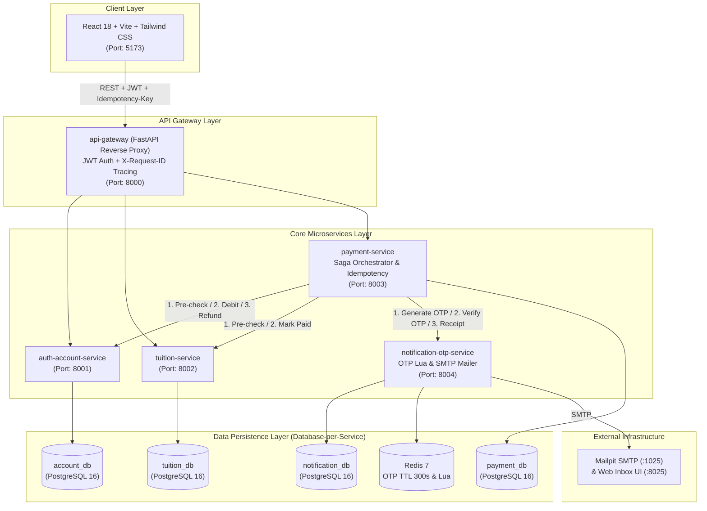

# DỰ ÁN GIỮA KỲ: PHÂN HỆ ĐÓNG HỌC PHÍ CỦA ỨNG DỤNG iBANKING (TDTU)
**Môn học:** Kiến Trúc Hướng Dịch Vụ (504070) – HK1/2026-2027  
**Trường Đại học Tôn Đức Thắng – Khoa Công nghệ Thông tin**

### Thông tin Thành viên Nhóm Thực hiện:
| STT | Họ và tên Sinh viên | Mã số Sinh viên (MSSV) | Email Sinh viên |
| :---: | :--- | :---: | :--- |
| 1 | **Trần Minh Nghĩa** | `524K0032` | `524k0032@student.tdtu.edu.vn` |
| 2 | **Huỳnh Trung Tín** | `524K0033` | `524k0033@student.tdtu.edu.vn` |
| 3 | **Phan Nguyễn Thảo Như** | `524V0007` | `524v0007@student.tdtu.edu.vn` |

---

## 1. TỔNG QUAN & ĐỐI CHIẾU TIÊU CHÍ CHẤM ĐIỂM

Hệ thống mô phỏng **phân hệ đóng học phí trực tuyến của ứng dụng TDTU iBanking**. Người dùng có thể sử dụng số dư khả dụng trong tài khoản để thanh toán toàn bộ khoản học phí của một sinh viên TDTU, cho chính mình hoặc cho sinh viên khác.

| Tiêu chí Rubric | Trọng số | Hiện thực trong Dự án | Tài liệu / Code Minh chứng |
| :--- | :---: | :--- | :--- |
| **1. Phân tích nghiệp vụ & UML** | `1.0đ` | Use Case Diagram và ERD mô tả các actor, entity, thuộc tính, khóa và quan hệ của 4 phân vùng dữ liệu (bao gồm `otp_tokens` và `notification_logs`). | [`docs/use_case_diagram.puml`](./docs/use_case_diagram.puml), [`docs/erd_diagram.puml`](./docs/erd_diagram.puml) |
| **2. Kiến trúc Microservices** | `1.5đ` | `api-gateway` + 4 Microservices độc lập (`auth-account`, `tuition`, `payment`, `notification-otp`), Database-per-Service trên PostgreSQL 16 + Redis 7 + Mailpit SMTP. | [`docs/architecture_diagram.puml`](./docs/architecture_diagram.puml), [`docs/sequence_diagram.puml`](./docs/sequence_diagram.puml) |
| **3. Thiết kế REST API** | `1.0đ` | Các API chính được mô tả theo REST, có request/response model, Pydantic v2 validation, error responses, `Idempotency-Key` và `X-Request-ID`. | [`docs/api_spec.md`](./docs/api_spec.md) |
| **4. Database & Data Persistence** | `1.0đ` | 4 PostgreSQL Databases độc lập với `CHECK (available_balance >= 0)`, `UNIQUE`, `FK`, `version` và tự động nạp Seed Data khi khởi chạy. | [`infra/postgres/init-multiple-dbs.sql`](./infra/postgres/init-multiple-dbs.sql) |
| **5. Hiện thực chức năng & Payment Workflow** | `2.0đ` | Đăng nhập JWT, tra cứu học phí theo MSSV, khởi tạo thanh toán toàn bộ, sinh và gửi OTP (TTL 5 phút, dùng một lần), trừ tiền, gạch nợ, lưu lịch sử và gửi email biên lai. | `services/` |
| **6. Transaction & Concurrency** | `1.5đ` | Không giữ row lock trong thời gian chờ OTP; dùng **pessimistic locking (`SELECT ... FOR UPDATE`)** khi xử lý giao dịch và Saga compensation khi phát hiện thanh toán trùng. | [`services/payment-service/app/routers/payments.py`](./services/payment-service/app/routers/payments.py) |
| **7. User Interface & Integration** | `0.5đ` | Giao diện React 18 + Vite + Tailwind CSS hiện đại, tích hợp thật với Backend qua API Gateway. | `frontend/` |
| **8. Documentation, Deployment & Demonstration** | `1.5đ` | Có hướng dẫn chạy bằng `docker-compose.yml` và bộ kiểm thử E2E cùng 2 kịch bản concurrency. | [`docker-compose.yml`](./docker-compose.yml), `tests/` |

---

## 2. KIẾN TRÚC MICROSERVICES & SƠ ĐỒ TỔNG QUAN



### Giải thích thiết kế concurrency và Saga:
1. **Không giữ Database Row Lock trong 5 phút chờ nhập OTP:**
   - Bước khởi tạo (`POST /api/v1/payments/initiate`) chỉ thực hiện **pre-check đọc dữ liệu** (kiểm tra học phí tồn tại, đang `UNPAID`, và `available_balance >= amount`), tạo bản ghi `PENDING_OTP` và gửi mã OTP qua email.
   - Khóa bi quan **`SELECT ... FOR UPDATE`** được kích hoạt khi người dùng xác thực mã OTP (`POST /api/v1/payments/{id}/confirm-otp`), thay vì giữ khóa trong thời gian chờ nhập OTP.
2. **Xử lý Concurrency 1 (Nhiều giao dịch đồng thời trên cùng 1 tài khoản):**
   - `auth-account-service` thực thi `SELECT ... FROM users_accounts WHERE id = :id FOR UPDATE` trong transaction trừ tiền, kết hợp kiểm tra `available_balance >= amount` và ràng buộc `CHECK (available_balance >= 0)`. Giao dịch đến sau khi số dư không còn đủ sẽ bị từ chối (`409 Conflict - INSUFFICIENT_BALANCE`).
3. **Xử lý Concurrency 2 (Nhiều tài khoản cùng thanh toán cho 1 MSSV):**
   - `tuition-service` thực thi `SELECT ... FROM tuition_bills WHERE id = :id FOR UPDATE` và chỉ cho phép chuyển trạng thái khi `status == 'UNPAID'`.
   - Chỉ một giao dịch gạch nợ thành công (`200 OK`). Giao dịch thứ hai nhận `409 Conflict`.
   - Khi nhận mã `409` từ `tuition-service`, **Saga Orchestrator (`payment-service`) gọi Compensating API (`POST /internal/accounts/refund`)** để hoàn trả số tiền đã trừ và ghi nhận trạng thái `COMPENSATED`.

---

## 3. HƯỚNG DẪN CÀI ĐẶT & KHỞI CHẠY HỆ THỐNG

### Yêu cầu môi trường:
- **Docker** và **Docker Compose** (Docker Desktop trên Windows/macOS hoặc Docker Engine trên Linux).

### Khởi chạy toàn bộ hệ thống với 1 lệnh duy nhất:
```bash
docker compose up --build -d
```

### Danh sách Cổng dịch vụ (Service Ports):
| Thành phần | URL Truy cập | Mô tả |
| :--- | :--- | :--- |
| **Giao diện Web (Frontend)** | [http://localhost:5173](http://localhost:5173) | Giao diện người dùng TDTU iBanking (React + Vite + Tailwind CSS) |
| **Hộp thư Email (Mailpit UI)** | [http://localhost:8025](http://localhost:8025) | Xem trực tiếp các Email chứa mã OTP và Email Biên lai xác nhận |
| **API Gateway (Swagger UI)** | [http://localhost:8000/docs](http://localhost:8000/docs) | Cổng vào duy nhất cho mọi REST API (`/api/v1/*`) |
| **Auth & Account Service** | [http://localhost:8001/docs](http://localhost:8001/docs) | Quản lý tài khoản, JWT & trừ/hoàn tiền nguyên tử |
| **Tuition Service** | [http://localhost:8002/docs](http://localhost:8002/docs) | Quản lý sinh viên TDTU & gạch nợ học phí |
| **Payment Service (Saga)** | [http://localhost:8003/docs](http://localhost:8003/docs) | Saga Orchestrator, Idempotency & Lịch sử giao dịch |
| **Notification & OTP Service** | [http://localhost:8004/docs](http://localhost:8004/docs) | Sinh/Xác thực OTP trên Redis + PostgreSQL & gửi SMTP |

---

## 4. DỮ LIỆU MẪU TỰ ĐỘNG NẠP (SEED DATA)

### 4.1. Danh sách Tài khoản Người dùng (`Mật khẩu mặc định: Password@123`)
| Username | Password | Họ và tên | Email | Số dư khả dụng | Mục đích Kiểm thử / Demo |
| :--- | :--- | :--- | :--- | ---: | :--- |
| `524K0032` | `Password@123` | Trần Minh Nghĩa | `524k0032@student.tdtu.edu.vn` | `50,000,000 VNĐ` | Tài khoản thành viên nhóm phục vụ Demo trên lớp. |
| `524K0033` | `Password@123` | Huỳnh Trung Tín | `524k0033@student.tdtu.edu.vn` | `50,000,000 VNĐ` | Tài khoản thành viên nhóm phục vụ Demo trên lớp. |
| `524V0007` | `Password@123` | Phan Nguyễn Thảo Như | `524v0007@student.tdtu.edu.vn` | `50,000,000 VNĐ` | Tài khoản thành viên nhóm phục vụ Demo trên lớp. |
| `nguyenvana` | `Password@123` | Nguyễn Văn A | `nguyenvana@tdtu.edu.vn` | `25,000,000 VNĐ` | Đủ đóng 1 khoản `14.5M`, dùng test luồng chính & **Concurrency 1** (đóng 2 khoản `14.5M` cùng lúc). |
| `tranvanb` | `Password@123` | Trần Văn B | `tranvanb@tdtu.edu.vn` | `30,000,000 VNĐ` | Dùng cùng `nguyenvana` đóng cho cùng 1 MSSV để test **Concurrency 2 + Saga Refund**. |
| `lethic` | `Password@123` | Lê Thị C | `lethic@tdtu.edu.vn` | `5,000,000 VNĐ` | Số dư nhỏ hơn học phí → kiểm thử nút *"Xác nhận giao dịch"* trên UI. |
| `phamvand` | `Password@123` | Phạm Văn D | `phamvand@tdtu.edu.vn` | `100,000,000 VNĐ` | Tài khoản số dư lớn để demo đóng nhiều khoản học phí liên tiếp. |

### 4.2. Danh sách Sinh viên TDTU & Khoản Học phí Mẫu
| MSSV | Họ và tên Sinh viên | Khoa / Ngành | Số tiền Học phí | Trạng thái Ban đầu |
| :---: | :--- | :--- | ---: | :---: |
| `524K0032` | **Trần Minh Nghĩa** | CNTT – Kỹ thuật Phần mềm | `15,000,000 VNĐ` | `UNPAID` |
| `524K0033` | **Huỳnh Trung Tín** | CNTT – Khoa học Máy tính | `15,000,000 VNĐ` | `UNPAID` |
| `524V0007` | **Phan Nguyễn Thảo Như** | CNTT – Hệ thống Thông tin | `14,000,000 VNĐ` | `UNPAID` |
| `52200001` | Trần Minh Khoa | CNTT – Kỹ thuật Phần mềm | `14,500,000 VNĐ` | `UNPAID` |
| `52200002` | Lê Hoàng Nam | CNTT – Khoa học Máy tính | `14,500,000 VNĐ` | `UNPAID` |
| `52200003` | Nguyễn Ngọc Mai | Quản trị Kinh doanh – Marketing | `12,000,000 VNĐ` | `UNPAID` |
| `52200004` | Phạm Quốc Bảo | Điện - Điện tử – Tự động hóa | `16,000,000 VNĐ` | `UNPAID` |
| `52200005` | Võ Thị Thanh Tâm | Kế toán – Kế toán Kiểm toán | `13,500,000 VNĐ` | `PAID` *(Đã đóng sẵn)* |

---

## 5. CHẠY BỘ KIỂM THỬ TỰ ĐỘNG (E2E & 2 KỊCH BẢN CONCURRENCY)

Sau khi các container Docker đã khởi chạy (`docker compose up -d`), có thể chạy bộ kiểm thử tự động cho luồng nghiệp vụ và hai tình huống concurrency:

```bash
pip install -r tests/requirements.txt
python tests/run_all_tests.py
```
Hoặc chạy bằng `pytest`:
```bash
pytest tests/ -v -s
```

Bộ kiểm thử gồm 3 kịch bản:
1. **[`tests/test_e2e_workflow.py`](./tests/test_e2e_workflow.py):** Kiểm tra luồng E2E, `X-Request-ID`, `Idempotency-Key`, các quy tắc thanh toán, OTP một lần và Saga Step Logs.
2. **[`tests/test_concurrency_same_account.py`](./tests/test_concurrency_same_account.py):** Gửi đồng thời hai lệnh `confirm-otp` cho cùng tài khoản `nguyenvana`, với hai khoản `14,500,000 VNĐ`. Kết quả mong đợi là một giao dịch `200 OK`, một giao dịch `409 INSUFFICIENT_BALANCE`, và số dư cuối cùng `10,500,000 VNĐ`.
3. **[`tests/test_concurrency_same_tuition.py`](./tests/test_concurrency_same_tuition.py):** Gửi đồng thời hai lệnh `confirm-otp` từ `nguyenvana` và `tranvanb` cho MSSV `52200001`. Kết quả mong đợi là một giao dịch thành công, giao dịch còn lại được hoàn tiền bù trừ và chuyển sang trạng thái `COMPENSATED`.
